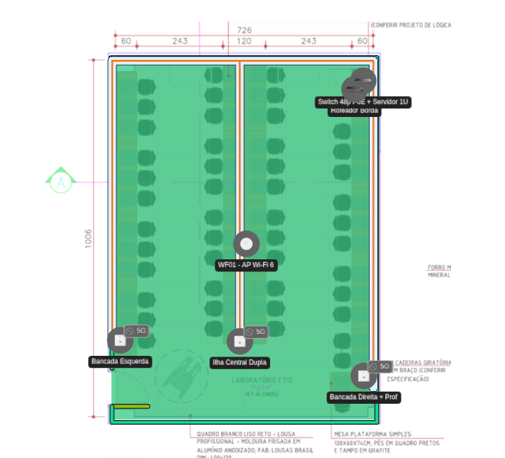

# Projeto Físico — Laboratório CT-12 (Sala 201) & OpenCloud

## 1. Planta Baixa de Infraestrutura e Lançamento de Cabos

A Sala 201 fica no **2º pavimento do CT-12** e possui área total de **72,63 m²** (`7,26 m × 10,06 m`), acomodando **48 posições nas bancadas** (47 computadores de alunos + 1 mesa do professor no ponto `1202`), espaço acessível para **PNE** e **1 Access Point Wi-Fi 6 no teto (`WF01`)**.

Abaixo está o diagrama físico montado no **Omada Design Hub**, mostrando o posicionamento do Rack no canto superior direito, o caminho das bandejas de cabos/eletrodutos até as três zonas de bancadas e a mancha de cobertura do sinal Wi-Fi 6 (`5 GHz`) cobrindo toda a sala:



### 1.1 Infraestrutura de Encaminhamento (100% Embutida)
Conforme o Item 2.2.2 do Termo de Referência, todas as canaletas plásticas e instalações aparentes antigas serão demolidas/retiradas. O novo lançamento de cabos será **100% embutido**, dividido em quatro níveis:

1. **Acima do Forro Mineral (Caminhamento Principal):**
   - Aproveitamento da **eletrocalha metálica perfurada `200×100 mm`** existente acima do forro para a chegada principal dos cabos no Rack.
   - Distribuição por **eletrodutos de PVC rígido roscável anti-chama (`3/4"`, `1"` e `1½"`)** passando por cima do forro mineral, interligando o Rack e o Quadro Elétrico (`QD-B`) às descidas das paredes, ao ponto do **Access Point (`WF01`)** no centro do teto e ao **Projetor Multimídia** (Circuito `B13` + duto HDMI).
2. **Embutido nas Paredes (Alvenaria):**
   - Descidas pelas paredes laterais mediante abertura e fechamento de **20,00 m de rasgos em alvenaria** (Item 2.9.1) até caixas `4×4"` instaladas a `30 cm` do piso acabado, alimentando a **Bancada Esquerda** e a **Bancada Direita + Mesa do Professor**.
3. **Embutido no Piso (Granilite):**
   - Para atender a **Ilha Central Dupla** sem deixar fios aparentes no chão nem postes descendo do teto, os cabos passam por **eletrodutos de PVC rígido de `1"` embutidos diretamente no piso de granilite**.
4. **Embutido no Mobiliário (Bancadas):**
   - Todas as bancadas possuem eletrocalhas próprias internas na estrutura das mesas, levando os cabos de rede Cat.6 e de energia de forma oculta até as tomadas do tampo (**1 ponto RJ-45 + 2 tomadas elétricas por posto**, somando **96 tomadas elétricas** no laboratório).

---

## 2. Layout e Diagrama de Ocupação do Rack (24U)

O Termo de Referência especifica um **Rack Fechado de Parede padrão 19" de `24U × 570 mm` de profundidade**, acompanhado dos seguintes acessórios passivos:
- **2 Patch Panels de 24 portas Cat.6** (totalizando 48 portas para as bancadas `1201` a `1248`)
- **8 Guias de Cabo Horizontais de 1U**
- **8 Placas Cegas de 1U** (para fechamento estético e direcionamento do fluxo de ar)
- **2 Bandejas Fixas de 1U** (capacidade `20 kg`)
- **1 Calha de 6 Tomadas de 20A (1U)**

Como o rack tem `570 mm` de profundidade, o **Servidor Físico do OpenCloud** escolhido é de chassi curto (**1U *Short-Depth* `≤ 430 mm`**), e o **NoBreak Senoidal Online (2U)** fica posicionado na base (`U01`–`U02`) por ser o equipamento mais pesado.

### 2.1 Elevação Vertical do Rack 19" (`24U × 570 mm`)

```text
  ======================================================================
                 SISTEMA DE EXAUSTÃO (TETO DO RACK 24U)
  ======================================================================
  [U24] [================ DIO / CHEGADA FIBRA ÓPTICA UFES ===============]
  [U23] [------------------ GUIA DE CABO HORIZONTAL 01 (1U) -------------]
  [U22] [================= ROTEADOR / FIREWALL DE BORDA =================]
  [U21] [====================== BANDEJA FIXA 01 (1U) ====================]
  [U20] [------------------ GUIA DE CABO HORIZONTAL 02 (1U) -------------]
  [U19] [=========== PATCH PANEL 01 - 24P CAT.6 (PONTOS 1201-1224) ======]
  [U18] [------------------ GUIA DE CABO HORIZONTAL 03 (1U) -------------]
  [U17] [===== SWITCH GERENCIÁVEL 48P PoE + 4 SFP/SFP+ (ACESSO/CORE) ====]
  [U16] [------------------ GUIA DE CABO HORIZONTAL 04 (1U) -------------]
  [U15] [=========== PATCH PANEL 02 - 24P CAT.6 (PONTOS 1225-1248) ======]
  [U14] [------------------ GUIA DE CABO HORIZONTAL 05 (1U) -------------]
  [U13] [------------------ GUIA DE CABO HORIZONTAL 06 (1U) -------------]
  [U12] [======== SERVIDOR FÍSICO 1U SHORT-DEPTH (OPENCLOUD GPEI) =======]
  [U11] [------------------ GUIA DE CABO HORIZONTAL 07 (1U) -------------]
  [U10] [====================== BANDEJA FIXA 02 (1U) ====================]
  [U09] [------------------ GUIA DE CABO HORIZONTAL 08 (1U) -------------]
  [U08] [=================== PLACA CEGA DE FECHAMENTO 01 ================]
  [U07] [=================== PLACA CEGA DE FECHAMENTO 02 ================]
  [U06] [=================== PLACA CEGA DE FECHAMENTO 03 ================]
  [U05] [=================== PLACA CEGA DE FECHAMENTO 04 ================]
  [U04] [=================== PLACA CEGA DE FECHAMENTO 05 ================]
  [U03] [================= CALHA DE 6 TOMADAS 20A (PDU) =================]
  [U02] [     NO-BREAK (UPS) SENOIDAL ONLINE DUPLA CONVERSÃO (2U)        ] (2U)
  [U01] [________________________________________________________________]
  ======================================================================
                    BASE DO RACK (FIXAÇÃO EM PAREDE)
  ======================================================================
                    ::: ORGANIZADORES LATERAIS :::
  (Passam verticalmente da base ao topo nas laterais esquerda e direita,
   acomodando também as 3 Placas Cegas 1U sobressalentes de reserva do kit)
```

### 2.2 Detalhe de Ligação no Switch (`U17`)
Para conectar todos os **49 pontos da sala** mais o **Servidor OpenCloud** e o **Link da UFES** usando apenas 1 Switch de 48 portas:
- **Portas 1 a 24 (RJ-45 PoE):** Ligadas ao **Patch Panel 01 (`U19`)** com patch cords Cat.6 de `2,50 m` (Pontos `1201` a `1224`, incluindo o PC do Professor no `1202`).
- **Portas 25 a 48 (RJ-45 PoE):** Ligadas ao **Patch Panel 02 (`U15`)** com patch cords Cat.6 de `2,50 m` (Pontos `1225` a `1248`).
- **Porta Uplink SFP 1 (Fibra):** Recebe o link óptico vindo do **DIO (`U24`)** / **Roteador de Borda (`U22`)**.
- **Porta Uplink SFP 2 (10 Gbps SFP+ / 1 Gbps):** Ligada direto ao **Servidor Físico 1U OpenCloud (`U12`)**.
- **Porta Uplink SFP 3 (Transceiver SFP RJ-45):** Conecta o **49º cabo Cat.6** que vai direto pelo forro até o **Access Point Wi-Fi 6 (`WF01`)** no centro da sala.

---

## 3. Plano de Identificação e Certificação de Cabos

Todo o cabeamento horizontal utiliza **100% cabo UTP Cat.6 CM anti-chama** (total de **689,00 m** lançados na sala, equivalentes a 3 caixas de 305 m), **48 módulos RJ-45 fêmea (Keystone) Cat.6** nas tomadas das bancadas, **1 conector RJ-45 macho Cat.6** no teto para o ponto `WF01` e **97 Patch Cords Cat.6 flexíveis de 2,50 m** (48 no rack + 48 nas bancadas + 1 para o AP).

### 3.1 Padrão de Etiquetagem e Mapeamento dos 49 Pontos

Cada cabo recebe identificação visual nas duas pontas (no espelho da tomada da bancada e na porta correspondente do Patch Panel no Rack), seguindo o padrão do projeto executivo da UFES:

| Zona Física na Sala 201 (Omada) | Pontos de Rede | Patch Panel (Rack) | Portas do Switch | VLAN Alocada | Destino / Equipamento |
| :--- | :---: | :---: | :---: | :---: | :--- |
| **Mesa do Professor (Frente Direita)** | **`1202`** | `PP-01` (Porta `02`) | Porta `02` | `VLAN 10 (Gerência)` | Desktop do Professor (Dual HDMI → Monitor + Projetor de Teto) |
| **Bancada Lateral Direita** | **`1201`** e **`1203` a `1214`** (13 pontos) | `PP-01` (Portas `01` e `03`–`14`) | Portas `01` e `03`–`14` | `VLAN 30 (Usuários)` | 13 Desktops Compactos (SFF) de Alunos |
| **Ilha Central Dupla (Lado Direito)** | **`1215` a `1224`** (10 pontos) | `PP-01` (Portas `15`–`24`) | Portas `15`–`24` | `VLAN 30 (Usuários)` | 10 Desktops Compactos (SFF) de Alunos |
| **Ilha Central Dupla (Lado Esquerdo)** | **`1225` a `1236`** (12 pontos) | `PP-02` (Portas `01`–`12`) | Portas `25`–`36` | `VLAN 30 (Usuários)` | 12 Desktops Compactos (SFF) de Alunos |
| **Bancada Lateral Esquerda** | **`1237` a `1248`** (12 pontos) | `PP-02` (Portas `13`–`24`) | Portas `37`–`48` | `VLAN 30 (Usuários)` | 12 Desktops Compactos (SFF) de Alunos |
| **Centro do Forro Mineral (Teto)** | **`WF01`** (49º ponto) | Direto (Conector RJ-45 Cat.6) | Porta **`SFP 3`** (Transceiver RJ-45) | `VLAN 30 (Usuários)` | Access Point Wi-Fi 6 Corporativo de Teto (PoE) |
| **Interno ao Rack (`U12`)** | **`SRV-01`** | Ligação Direta no Rack | Porta **`SFP 2`** (10G SFP+ / 1G) | `VLAN 20 (Servidores)` | Servidor Físico 1U Short-Depth (OpenCloud) |

### 3.2 Relatório de Certificação dos 49 Pontos Cat.6 (Item 2.17.18 do TR)

Conforme exigido no Item 2.17.18 do Termo de Referência, todos os **49 pontos de rede Cat.6** passam por ensaio de certificação em campo com certificador homologado (padrão ANSI/TIA-568-C.2 / ISO/IEC 11801 para Classe E / Categoria 6 em `250 MHz`), verificando mapa de fios (*Wiremap*), comprimento, atenuação (*Insertion Loss*), paradiafonia (*NEXT*) e relação atenuação/paradiafonia (*ACR-F / FEXT*).

Abaixo está o resumo dos resultados do lote de certificação da Sala 201 (considerando o comprimento médio de `~14,0 m` por lance dentro do total de `689,00 m` de cabo lançado):

| ID do Ponto | Etiqueta no Rack | Comprimento Medido | Atenuação (Insertion Loss @ 250 MHz) | NEXT (Pior Par @ 250 MHz) | ACR-F / ELFEXT (@ 250 MHz) | Mapa de Fios (T568A) | Status Final |
| :---: | :---: | :---: | :---: | :---: | :---: | :---: | :---: |
| *Limite Norma Cat.6* | *TIA-568-C.2* | *Máx. `90,0 m` (Link)* | *Máx. `32,8 dB`* | *Mín. `38,3 dB`* | *Mín. `19,8 dB`* | *Pinos 1–8 OK* | *Critério* |
| **`1201`** | `PP01-P01` | `11,5 m` | `6,2 dB` | `49,4 dB` | `34,1 dB` | `1-8 OK` | ✅ **PASS** |
| **`1202` (Prof)** | `PP01-P02` | `18,0 m` | `8,9 dB` | `48,1 dB` | `31,5 dB` | `1-8 OK` | ✅ **PASS** |
| **`1203` a `1214`** | `PP01-P03..P14` | `9,0 m – 17,5 m` | `5,1 – 8,7 dB` | `47,8 – 51,2 dB` | `31,0 – 35,4 dB` | `1-8 OK` | ✅ **PASS (12/12)** |
| **`1215` a `1224`** | `PP01-P15..P24` | `12,0 m – 19,5 m` | `6,4 – 9,5 dB` | `46,9 – 50,1 dB` | `30,2 – 33,8 dB` | `1-8 OK` | ✅ **PASS (10/10)** |
| **`1225` a `1236`** | `PP02-P01..P12` | `12,5 m – 20,0 m` | `6,6 – 9,8 dB` | `46,5 – 49,9 dB` | `29,8 – 33,5 dB` | `1-8 OK` | ✅ **PASS (12/12)** |
| **`1237` a `1248`** | `PP02-P13..P24` | `10,5 m – 21,5 m` | `5,8 – 10,4 dB` | `46,2 – 50,5 dB` | `29,4 – 34,0 dB` | `1-8 OK` | ✅ **PASS (12/12)** |
| **`WF01` (Teto)** | `SW-SFP3` | `13,0 m` | `6,8 dB` | `49,0 dB` | `33,2 dB` | `1-8 OK (PoE)` | ✅ **PASS** |
| **TOTAL** | **49 Pontos** | **689,00 m (Total)** | **Dentro do limite** | **Margem > 7 dB** | **Margem > 9 dB** | **100% T568A** | ✅ **49/49 APROVADOS** |
