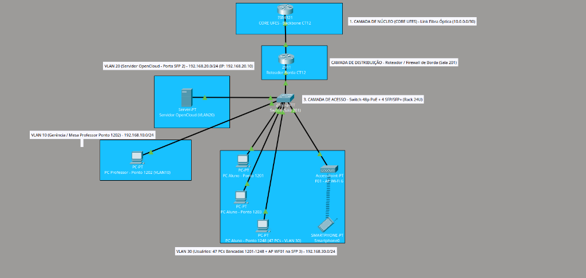
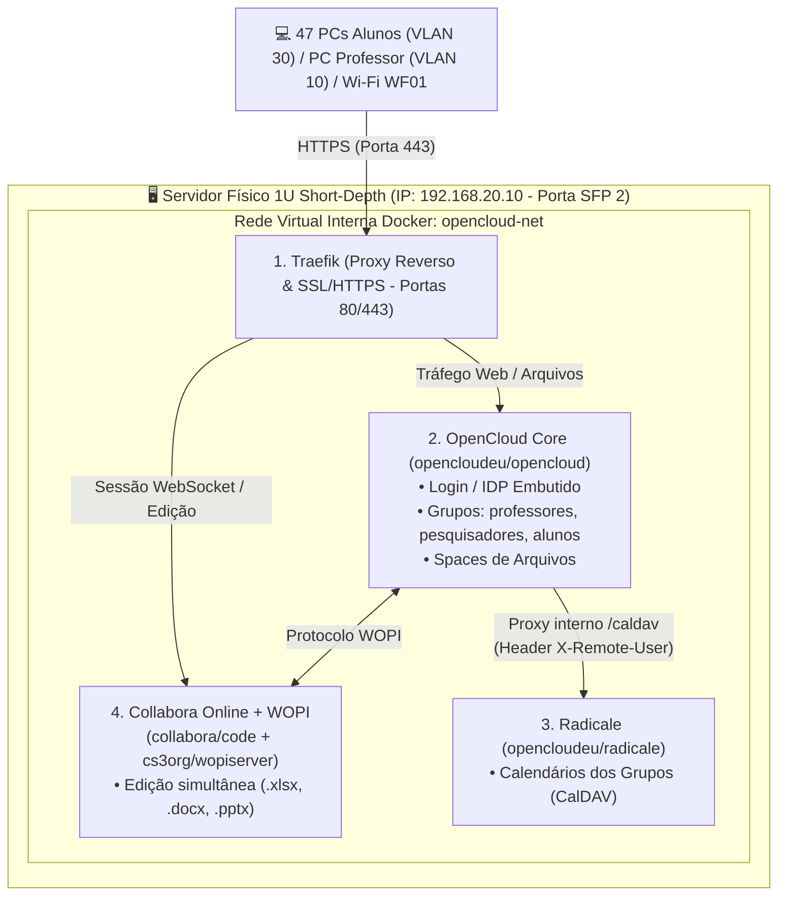

# Projeto Lógico — Laboratório CT-12 (Sala 201) & OpenCloud

> [!NOTE]
> Este documento detalha a arquitetura lógica da rede da **Sala 201 (CT-12)** para o **Grupo de Pesquisa e Ensino de Engenharia Industrial (GPEI)**. A modelagem foi construída e validada no **Cisco Packet Tracer**, dividindo a rede no modelo hierárquico de três camadas, isolando os ambientes por VLANs e estruturando o servidor **OpenCloud** em containers Docker.

---

## 1. Diagrama de Arquitetura de Rede em Três Camadas

A topologia abaixo foi montada no **Cisco Packet Tracer** para representar a separação entre o link que chega da UFES, o roteamento de borda do laboratório e a camada de acesso onde ficam os computadores, o Wi-Fi e o servidor local:

### Funcionamento das 3 Camadas na Sala 201:
1. **Camada de Núcleo (Core UFES):**
   - Representa o backbone central do prédio CT-12 / UFES, que chega até o rack da Sala 201 por um **cabo de Fibra Óptica** através de um eletroduto de `1½"` (Item 2.17.19 do TR).
2. **Camada de Distribuição (Roteador / Firewall de Borda):**
   - Recebe o link da UFES e faz o roteamento entre as VLANs internas (*Router-on-a-Stick*), além de atuar como servidor **DHCP**, **NAT** para saída à internet e **Firewall** aplicando as regras de controle de acesso (ACLs) entre as sub-redes.
3. **Camada de Acesso (Switch Gerenciável 48 Portas PoE + 4 SFP/SFP+):**
   - Instalado no Rack de 24U da sala, conecta todos os dispositivos finais:
     - **Portas 1 a 48 (RJ-45 Gigabit PoE):** Ligadas aos 2 Patch Panels de 24 portas para atender a **mesa do professor (`1202`)** e as **47 bancadas dos alunos (`1201` e `1203` a `1248`)**.
     - **Porta SFP 1:** Usada para o uplink principal.
     - **Porta SFP 2 (10 Gbps SFP+ / 1 Gbps):** Dedicada ao **Servidor Físico 1U do OpenCloud**, evitando gargalo quando os 47 alunos acessam arquivos ao mesmo tempo.
     - **Porta SFP 3 (com Transceiver RJ-45):** Conecta o **49º ponto de rede (`WF01`)**, que fica no centro do forro mineral para o **Access Point Wi-Fi 6**.

---

## 2. Plano de Endereçamento IP e Alocação de VLANs

Para evitar que o tráfego das bancadas dos alunos se misture com a gerência dos equipamentos ou com o acesso direto ao servidor, a rede local foi dividida em **3 VLANs (padrão IEEE 802.1Q)**, além do enlace ponto a ponto com o Core da UFES:

| VLAN / Enlace | Nome da VLAN | Sub-rede IPv4 | Máscara | Gateway Padrão | Faixa de Uso e Equipamentos Alocados |
| :---: | :--- | :--- | :--- | :--- | :--- |
| **Enlace WAN** | `UPLINK_UFES` | `10.0.0.0/30` | `255.255.255.252` | `10.0.0.1` | Link em fibra óptica entre o Core UFES (`10.0.0.1`) e o Roteador de Borda da Sala 201 (`10.0.0.2`). |
| **VLAN 10** | `GERENCIA` | `192.168.10.0/24` | `255.255.255.0` | `192.168.10.1` | • **IP do Switch 48p:** `192.168.10.2` • **Mesa do Professor (Ponto `1202`):** `192.168.10.10` • Usada para administração dos ativos e docência. |
| **VLAN 20** | `SERVIDORES` | `192.168.20.0/24` | `255.255.255.0` | `192.168.20.1` | • **Servidor Físico 1U OpenCloud (Porta SFP 2):** `192.168.20.10` (IP estático). • Rede isolada (DMZ interna) exclusiva para o servidor. |
| **VLAN 30** | `USUARIOS` | `192.168.30.0/24` | `255.255.255.0` | `192.168.30.1` | • **47 PCs dos Alunos (`1201`, `1203`–`1248`):** `192.168.30.11` a `192.168.30.57` (via DHCP). • **Access Point Wi-Fi 6 (`WF01` na SFP 3) e Dispositivos Móveis:** `192.168.30.100` a `192.168.30.250` (via DHCP). |

---

## 3. Matriz de Fluxo de Tráfego e Regras de Firewall (ACLs)

O Roteador/Firewall de Borda controla o que pode passar de uma VLAN para outra. Dessa forma, os alunos conseguem usar o **OpenCloud** pelo navegador normalmente, mas ficam bloqueados de acessar o terminal SSH do servidor ou o painel de configuração do Switch:

| Regra | Origem | Destino | Protocolo / Porta | Ação | Justificativa no Projeto |
| :---: | :--- | :--- | :---: | :---: | :--- |
| **01** | `VLAN 10 (Gerência)` e `VLAN 30 (Usuários)` | `Servidor OpenCloud` (`192.168.20.10`) | `TCP 80` (HTTP) e `TCP 443` (HTTPS) | ✅ **PERMITIR** | Permite que os 47 PCs dos alunos, o PC do professor e os dispositivos no Wi-Fi acessem o OpenCloud, o Collabora e o calendário via proxy Traefik. |
| **02** | `VLAN 10 (Gerência)` e `VLAN 30 (Usuários)` | `Servidor OpenCloud` / DNS (`192.168.20.10`) | `UDP/TCP 53` (DNS) | ✅ **PERMITIR** | Resolução de nomes local (ex.: `opencloud.gpei.ufes.br`) e encaminhamento de consultas DNS. |
| **03** | `VLAN 10 (Gerência)` | `VLAN 20 (Servidor)` e `VLAN 10 (Switch)` | `TCP 22` (SSH) e `UDP 161` (SNMP) | ✅ **PERMITIR** | Libera administração remota via SSH no servidor OpenCloud e gerência do Switch apenas a partir da VLAN de Gerência. |
| **04** | `VLAN 30 (Usuários)` | `VLAN 10 (Gerência)` | `Qualquer (ALL)` | ❌ **BLOQUEAR** | Impede que computadores das bancadas de alunos ou celulares no Wi-Fi tentem acessar o Switch ou o PC do professor. |
| **05** | `VLAN 30 (Usuários)` | `Servidor OpenCloud` (`192.168.20.10`) | `TCP 22` (SSH) e portas internas (`9200`, `9980`, `5232`) | ❌ **BLOQUEAR** | Garante que os alunos só acessem o servidor pela porta web segura (`443` do Traefik), bloqueando tentativas de login SSH ou acesso direto aos containers. |
| **06** | `VLAN 10`, `VLAN 20` e `VLAN 30` | `Core UFES / Internet` | `TCP 80, 443` / `UDP 123` (NTP) | ✅ **PERMITIR** | Acesso à internet acadêmica da UFES, atualizações de pacotes Linux/Docker e sincronização de relógio (NTP). |

---

## 4. Arquitetura do Serviço de Software Livre (OpenCloud)

Dentro do **Servidor Físico 1U Short-Depth (`192.168.20.10`)** instalado no Rack 24U da Sala 201, o sistema operacional base é o **Linux (Ubuntu Server LTS)** rodando **Docker** e **Docker Compose**.

Para manter a organização e a segurança, todos os serviços rodam isolados dentro de uma rede virtual interna do Docker chamada **`opencloud-net`**. Apenas o proxy reverso (`Traefik`) fica com as portas `80` e `443` abertas para a rede do laboratório.

### 4.1 Os 4 Containers da Pilha OpenCloud

| Container / Serviço | Imagem Docker | Função no Laboratório (GPEI) |
| :--- | :--- | :--- |
| **1. Traefik** | `traefik` | **Proxy Reverso e SSL/TLS:** Recebe todas as conexões HTTPS (porta `443`) vindas das bancadas e do Wi-Fi, gerencia os certificados de segurança e encaminha cada requisição para o container correto. |
| **2. OpenCloud Core** | `opencloudeu/opencloud` | **Núcleo da Nuvem Privada:** Escrito em linguagem Go e *database-less* (grava os dados direto no sistema de arquivos em RAID 1, sem precisar de um banco SQL pesado). Cuida do login dos usuários (**IDP embutido**), separa os **3 grupos (`professores`, `pesquisadores`, `alunos`)** e gerencia os **Spaces** de arquivos. |
| **3. Radicale** | `opencloudeu/radicale` | **Servidor de Calendário (CalDAV/CardDAV):** Recebe as conexões já autenticadas pelo OpenCloud através do endereço `/caldav` (usando o cabeçalho `X-Remote-User`), mantendo as agendas de reuniões dos grupos de pesquisa e datas de entrega das disciplinas. |
| **4. Collabora Online + WOPI** | `collabora/code` + `cs3org/wopiserver` | **Edição Simultânea no Navegador:** Integrado ao OpenCloud pelo protocolo **WOPI**, permite que alunos, pesquisadores e professores criem e editem planilhas (`.xlsx`), relatórios (`.docx`) e apresentações (`.pptx`) juntos e em tempo real direto pelo navegador. |

### 4.2 Diagrama do Fluxo Interno no Servidor (`192.168.20.10`)

